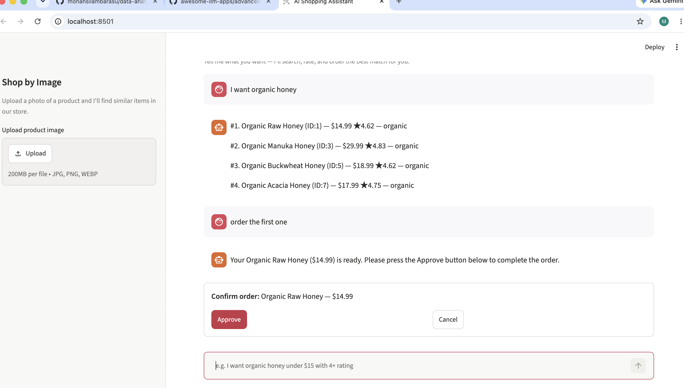
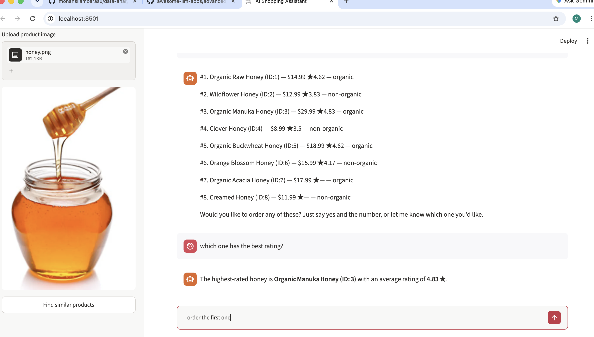
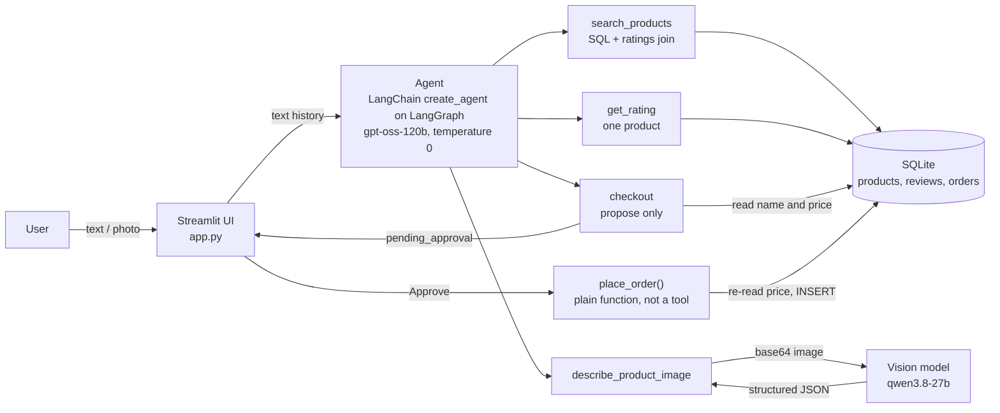
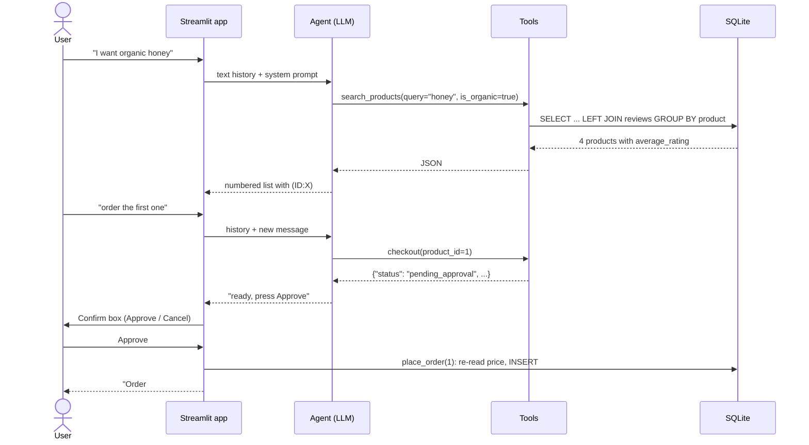

# AI Shopping Assistant

A conversational shopping agent that searches a product catalog, reads ratings, understands product photos, and prepares orders. The LLM decides *what to do*; deterministic code decides *what is allowed to happen*. Orders can only be written by a human-approved code path.

**Highlights**

- **Tool-calling (ReAct) agent** built with LangChain `create_agent` on LangGraph, using a hosted open-weight LLM (`gpt-oss-120b`) as the orchestrator.
- **Compound AI system:** a second, vision-capable model (`qwen3.8-27b`) is wrapped as a tool and turns product photos into structured search parameters.
- **Code-enforced human-in-the-loop.** The model can only *propose* an order. A separate function, not exposed as a tool, writes it after the user presses Approve.
- **Evaluation harness against a SQL oracle.** 10 automated prompts plus an 11-query manual comparison. Expected answers come from the database, not from another model.
- **Evaluation-driven iteration.** Testing exposed four real failure modes (unconfirmed orders, ungrounded explanations, malformed tool-call JSON, missing ratings), each traced to a root cause and fixed. See [Engineering log](#engineering-log).

---

## Demo

Search, then order: the agent only prepares the order, and the Approve button writes it.

<table>
  <tr>
    <td width="50%"></td>
    <td width="50%"></td>
  </tr>
  <tr>
    <td align="center"><sub>Text search, then order with Approve / Cancel</sub></td>
    <td align="center"><sub>Photo search, then follow-up question</sub></td>
  </tr>
</table>

---

## Architecture



### Request flow



**Photo search:** the agent calls `describe_product_image`, which sends the image to the vision model and gets back JSON (`product_type`, `search_query`, `is_organic`, `description`). The agent then calls `search_products` with those values and continues as above.

---

## AI engineering concepts

| Concept | Where it appears | Why it matters |
|---|---|---|
| **ReAct / tool-calling agent** | `create_agent` with four tools | The model chooses the next action per request instead of following a fixed script |
| **Compound AI system, model-as-a-tool** | `describe_product_image` wraps a second model | Keeps the orchestrator text-only and lets each model be swapped independently |
| **Multimodal input with structured extraction** | Base64 image, JSON-only prompt | Converts an image into parameters a database tool can use |
| **Tool design** | Small typed tools, parameterized SQL, compact JSON outputs | The model can only do what the tools allow; smaller outputs mean fewer tokens and fewer failure points |
| **Trust boundary and guardrails in code** | `checkout` proposes, `place_order` commits | Safety rules that matter are enforced by code, not by a prompt the model might ignore |
| **Human-in-the-loop approval** | Approve / Cancel in the UI | A person confirms the exact product and price before anything is written |
| **Grounding** | Order confirmations are generated by the app from the database result | The model cannot invent order numbers, shipping times or prices |
| **Context management** | Stateless backend, full text history resent, `(ID:X)` carried in visible replies | Follow-ups such as "the first one" work without server-side memory |
| **Prompt as a specification** | System prompt with explicit modes (image search, browsing, ordering), clarification and refusal rules | Behavior is written down and testable |
| **Deterministic decoding** | `temperature=0` | Results are as repeatable as the provider allows, which makes evaluation meaningful |
| **Evaluation against an oracle** | SQL computes the expected answer; the agent is compared to it | Measures correctness without using another model as the judge |

## Software design patterns

- **Propose / commit (two-phase action).** `checkout` returns a pending record; `place_order` performs the write. The two are separated so approval sits between them.
- **Adapter / facade.** A vision model is exposed to the agent through the same tool interface as a SQL query.
- **Single source of truth.** Prices are read from the database at proposal time and again at commit time; the model never supplies a price.
- **Separation of concerns.** UI (`app.py`), agent and tools (`shopping_agent.py`), data seeding (`setup_db.py`), rating logic (`reviews_api.py`) and evaluation (`eval_agent.py`) are separate modules.
- **Oracle testing.** The correct answer is computed independently of the system under test.

---

## Design decisions and tradeoffs

| Decision | Alternatives considered | Rationale | Tradeoff accepted |
|---|---|---|---|
| Agent with tools | Fixed pipeline | Requests vary: search, rate, clarify, order | Less predictable than a pipeline; mitigated by tests and code guardrails |
| Fixed, typed tools | Let the model write SQL | The model cannot reach anything the tools do not expose | Less flexible queries |
| Single agent with a prose state machine | Multi-agent or explicit graph | Simplest design that meets the requirements | Prompt rules can be ignored, so the one critical rule (ordering) is enforced in code |
| Vision model as a tool | One multimodal orchestrator | Orchestrator stays text-only; models are independently replaceable | One extra model call; the image path passes through the LLM |
| State in visible text (`(ID:X)`) | Server-side session store | Backend stays stateless and simple | Relies on the model copying IDs correctly (covered by ordering tests) |
| Ratings joined into search results | One `get_rating` call per product | See Engineering log: per-product calls caused malformed tool-call JSON | Search does more work; long descriptions are no longer returned to the model |
| Approval enforced in code | Prompt-only confirmation | Prompt rules are not guarantees | One extra click for the user |
| Keyword `LIKE` search | Embedding or hybrid retrieval | Deterministic, easy to verify against SQL | No synonyms; multi-word phrases match as a whole |
| `temperature=0`, hosted open-weight models | Larger proprietary models | Reproducible and inexpensive to run | Occasional provider-side output quirks; handled by evaluation and, on the roadmap, by retry logic |

---

## Engineering log

Failures found by testing, with root cause and fix.

| # | Failure | How it was found | Root cause | Fix |
|---|---|---|---|---|
| 1 | "Order the first one" placed an order immediately, for a product the user may not have meant | Manual testing | The only protection was a sentence in the prompt | Propose/commit gate with Approve/Cancel; prompt now requires asking when the target is unclear |
| 2 | Asked why the order number was 9, the agent invented an explanation ("orders from other customers") and shipping claims | Follow-up questions in the UI | Ungrounded model text; the app has no customers or shipping data | Confirmations are generated by code from the database result; prompt forbids shipping or delivery claims |
| 3 | HTTP 400 `tool_use_failed` (malformed tool-call JSON) on broad queries such as "organic products under $15" | Manual comparison against SQL answers | One rating lookup per product (N+1) meant the model wrote many tool calls, and some contained invalid JSON | `search_products` joins ratings in a single SQL query; the model makes one call |
| 4 | Some ratings were missing in photo-search replies although every product has reviews | Manual comparison against SQL answers | Same N+1 pattern: lookups were sometimes skipped | Same fix as #3 |
| 5 | Provider retired the original models, causing a startup 404 | First run | Model IDs were pinned to deprecated releases | Migrated orchestrator and vision models; model IDs live in one place |

---

## Evaluation

### Automated (`eval_agent.py`): 10/10 passing

For each prompt the script computes the correct answer from the database with SQL, asks the real agent, and compares product IDs, prices and ratings. It also asserts two invariants on every case: the agent never writes to the `orders` table, and never claims an order was "placed" or "shipped".

| # | Prompt | Type | Result |
|---|---|---|---|
| 1 | any organic tea? | category + organic filter | PASS |
| 2 | show me oils under $10 | category + price | PASS |
| 3 | organic products under $8 | filters only, no keyword | PASS |
| 4 | organic products rated 4.7 or higher | rating filter | PASS |
| 5 | what is the most expensive honey? | superlative, single answer | PASS |
| 6 | cheapest coffee you have | superlative, single answer | PASS |
| 7 | honey priced between $12 and $16 | price range | PASS |
| 8 | show me grains that are not organic | negation | PASS |
| 9 | show me coffee → order the Dark Roast Espresso Blend | ordering by name: order prepared, not placed | PASS |
| 10 | show me coffee → I'll take one | ambiguous request: nothing prepared | PASS |

### Manual comparison (`sql_checks.py`): 11 prompts

Eleven reference queries were run directly against SQLite, and the agent's replies in the UI were compared line by line (honey filters, rating thresholds, superlatives, oats, a no-match query, a no-keyword query, coffee).

- First pass: 8 matched exactly, 1 was partially correct (answered a "cheapest" question with a list), and 2 failed with the malformed tool-call error (Engineering log #3).
- After moving ratings into the search query, the two failing prompts and two others were re-tested and matched the SQL answers.

### Run it

```bash
uv run python sql_checks.py          # reference answers straight from the database
uv run python eval_agent.py          # all 10 automated cases (paced: 40 s between model calls)
uv run python eval_agent.py 4 5 9    # selected cases
```

---

## Getting started

```bash
uv sync
cp .env.example .env                 # add your Groq API key
uv run python setup_db.py            # creates store.db: 32 products, 9 categories, 102 reviews
uv run streamlit run app.py
```

Requirements: Python 3.12+, [uv](https://docs.astral.sh/uv/), a Groq API key.

## Tech stack

Python 3.12 · LangChain 1.x (`create_agent`) · LangGraph · `langchain-groq` · Groq-hosted `openai/gpt-oss-120b` (orchestrator) and `qwen/qwen3.8-27b` (vision) · Streamlit · SQLite · uv

## Project layout

| Path | Purpose |
|---|---|
| `app.py` | Streamlit chat, photo upload, Approve / Cancel |
| `shopping_agent.py` | Tools, system prompt, agent, `place_order` |
| `reviews_api.py` | Average rating and review count for one product |
| `setup_db.py` | Creates and seeds `store.db` |
| `eval_agent.py` | Automated evaluation with PASS / FAIL |
| `sql_checks.py` | Reference answers from SQL for manual comparison |
| `resources/` | Sample photos |

---

## Roadmap

- **Resilience:** catch provider tool-call errors and retry or degrade gracefully instead of surfacing an error.
- **Retrieval:** hybrid keyword and embedding search so synonyms ("oatmeal") and multi-word queries match, with the same SQL oracle used to measure the change.
- **Observability:** trace every model and tool call (LangSmith or Langfuse) and track token use per request.
- **Image handling:** pass uploaded images by handle instead of file path, and clean up temporary files.
- **Product features:** user accounts, order history, quantities and a cart.
- **Consistency:** unify rating rounding between `get_rating` and the search query.
- **CI:** run the evaluation on every change.