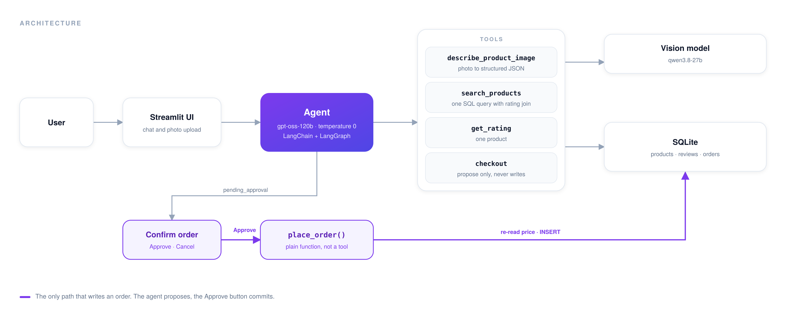

<h1 align="center">AI Shopping Assistant</h1>

<p align="center">
  A multimodal, tool-calling shopping agent with human-in-the-loop approval, guardrails enforced in code, and a manual and automated evaluation suite that checks every answer against the database.
</p>

<p align="center">
  
  
</p>

I designed, built, tested and evaluated this project end to end. It started from an open-source tutorial for a multimodal shopping assistant. The architecture changes, the approval gate, the evaluation suite and the fixes described below are my work.

## Problem

An agent that can place orders has one failure that matters: it acts on a guess. In the first version, "order the first one" bought an item the user may not have meant, and asking why an order number was 9 produced an invented explanation and a made-up delivery time. That is hallucination with side effects.

Text-only search also missed what shoppers actually have: a photo of a product.

## Solution

An agentic system where the language model decides what to do and deterministic code decides what is allowed to happen.

- **Agentic tool calling.** A ReAct-style agent chooses between search, rating, image and checkout tools for each request.
- **Multimodal input.** A vision-language model turns a product photo into structured search parameters.
- **Human-in-the-loop with guardrails in code.** The agent can only propose an order. A human-approved code path is the only thing that can write one.
- **Grounding.** Order numbers, prices and confirmations come from the database, never from the model.
- **Evaluation against ground truth.** Expected answers are computed with SQL, so correctness does not depend on another model.

## Architecture



- **Orchestrator.** LangChain `create_agent` on LangGraph, running `gpt-oss-120b` at temperature 0 with four small, typed tools.
- **Compound AI system.** A second model, `qwen3.8-27b`, is wrapped as a tool (`describe_product_image`). The orchestrator stays text-only and either model can be swapped independently.
- **Propose and commit.** `checkout` only returns a pending record. The Approve button calls `place_order()`, a plain function that is not exposed as a tool and re-reads the price from the database.
- **Stateless context management.** The backend keeps no session. The full text history is resent each turn and product IDs appear in replies as `(ID:X)`, so follow-ups such as "order the first one" resolve correctly.
- **Prompt as a specification.** The system prompt defines explicit modes (image search, browsing, ordering), output format and rules for asking before acting.
- **Safe data access.** Tools use parameterized SQL. The model cannot write queries.

## Engineering decisions and tradeoffs

- **Rules in code, not in the prompt.** Prompt rules can be ignored, so the critical rule, ordering, is enforced by the program. The cost is one extra click for the user.
- **Fixed tools instead of model-written SQL.** The model can only do what the tools expose, which is safer and more testable but less flexible.
- **One agent with a prompt-defined flow instead of a multi-agent graph.** It is the simplest design that meets the requirements.
- **Ratings joined into the search query.** One SQL call replaced a rating lookup per product, which removed a class of tool-call failures. Search does more work per call.
- **Keyword search instead of embeddings.** It is deterministic and easy to verify against SQL, but it has no synonym handling.
- **Open-weight models on Groq at temperature 0.** Fast, inexpensive and repeatable, with occasional provider-side output errors that evaluation is designed to catch.

## Failures found and fixed

- **The agent ordered without asking.** Saying "order the first one" placed the order immediately, even if the user meant a different item. I split ordering into two steps. The agent can only propose an order, and nothing is saved until the user presses Approve.
- **The agent made things up.** Asked why an order was number 9, it invented an explanation and promised "3-5 business days" delivery, though the app has no delivery data. Order confirmations now come from the database through code, and the prompt forbids delivery claims.
- **Broad searches crashed.** For a query like "organic products under $15," the agent made a separate rating lookup for every product, and the model sometimes wrote broken JSON that the API rejected. I reproduced it on specific prompts, then moved ratings into the main search query so the model makes one call. This also fixed ratings missing from some results.

## Evaluation and testing

**Automated evaluation, 10 of 10 passing.** Each prompt is answered by the real agent and compared with a SQL oracle on product IDs, prices and ratings. Every case also checks two invariants: the `orders` table is unchanged, and the reply never claims an order was placed or shipped. Cases cover category filters, price limits, rating thresholds, negation, superlatives, price ranges, ordering by name and an ambiguous request. The runner paces model calls and reports PASS or FAIL per case.

**Manual evaluation, 11 queries.** I wrote reference SQL for each query, ran the same questions in the UI and compared the answers line by line. First pass: 8 exact, 1 partial, 2 failed on the malformed-JSON error. After the fix, the failing prompts matched the SQL answers.

**Smoke tests.** I ran the full user journey end to end: text search, photo search, follow-up questions, order, Approve and Cancel, checking the `orders` table after each.

```bash
uv run python sql_checks.py          # reference answers from SQL
uv run python eval_agent.py          # automated evaluation
uv run python eval_agent.py 4 5 9    # selected cases
```

## Tech stack

- **Agent and models:** LangChain 1.x (`create_agent`), LangGraph, `langchain-groq`, Groq-hosted `openai/gpt-oss-120b` (orchestrator) and `qwen/qwen3.8-27b` (vision)
- **Application:** Python 3.12, Streamlit
- **Data:** SQLite with 32 products, 9 categories and 102 reviews
- **Tooling:** uv, python-dotenv

## Limitations

- Search is keyword-based: no synonyms, and a multi-word phrase matches as one string.
- No cost or latency measurements yet.
- The automated suite has 10 cases, which is a regression check and not a benchmark.

## Run it

Python 3.12+, [uv](https://docs.astral.sh/uv/) and a Groq API key.

```bash
uv sync
cp .env.example .env                 # add your key
uv run python setup_db.py
uv run streamlit run app.py
```
